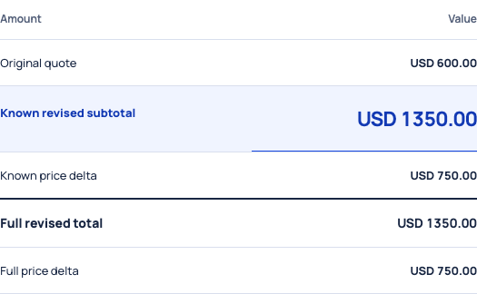

# Scope-change Desk

Turn a changed website request into a quote revision you can inspect, price and reopen. Keep the original quote, calculate exact amounts, and leave added work unresolved until its price and reference are supplied.

This repository contains this product and its required shared modules only. It runs independently of the original four-project suite.

## Run

Requires Node.js 22 or newer. Install the pinned dependencies, then start the loopback-only server:

```sh
npm ci
npm start
```

Open `http://127.0.0.1:4190/` for the landing. The same landing is available at `/products/scope`; the working UI is at `/scope`. `DESK_PORT` changes the port. `DESK_WORKSPACE` selects the parent directory of local projects where applicable. Managed records are stored beneath `work/desk` in that workspace; keep this directory private and outside version control.

## Verify

```sh
npx playwright install chromium
npm test
```

The browser installation is required for browser tests. An already installed browser can instead be selected with `PLAYWRIGHT_CHROMIUM_EXECUTABLE_PATH`. `npm run test:smoke` checks the standalone landing, working UI, evidence assets, session protections, denied sibling routes and unconfigured inference. Tests use local fixtures; no live provider credentials are required. Avoid supplying credentials while testing.

See [selected validation](VALIDATION.md) for the current check scope and results.

## Scope and boundaries

Create sourced quote revisions with exact minor-unit arithmetic. Missing prices remain unresolved. Saves preserve a local version; nothing is sent to a client, client approval is not recorded, and schedule feasibility is not validated. Optional NVIDIA Nemotron interpretation sends only explicitly approved selected quote fields and a client message; suggestions and citations require owner review.

Live sponsor inference and remote execution proof remain unverified. `.env.example` lists only this product's optional settings. Never commit `.env`, tokens, runtime records or user-selected project files. The server checks exact local Host/Origin, requires a session token for APIs, bounds request size, and serves only explicit static assets. Sibling product pages and APIs are absent.

## Product capture



Actual saved draft with synthetic quote inputs; client approval is not recorded.

## Evidence and tests retained

The landing screenshots are actual controlled local UI captures with textual alternatives and image failure fallbacks. JSON evidence is synthetic/controlled and carries its observation limits.

Product unit/service/browser suites and shared inference-runtime tests are retained. Relevant readiness and workflow browser cases were split by product without changing their assertions. Cited interpretation/planning unit cases were split from the shared workflow suite. Cross-product hub, marketing, motion, and shared multi-product browser suites are omitted; their route assumptions do not apply to a standalone repository. The standalone smoke suite covers the new server boundary. Historical private audit/output directories and old Git history are intentionally absent.

MIT licensed; the bundled self-hosted Manrope font license is in `src/desk/public/fonts/LICENSE.txt`.
